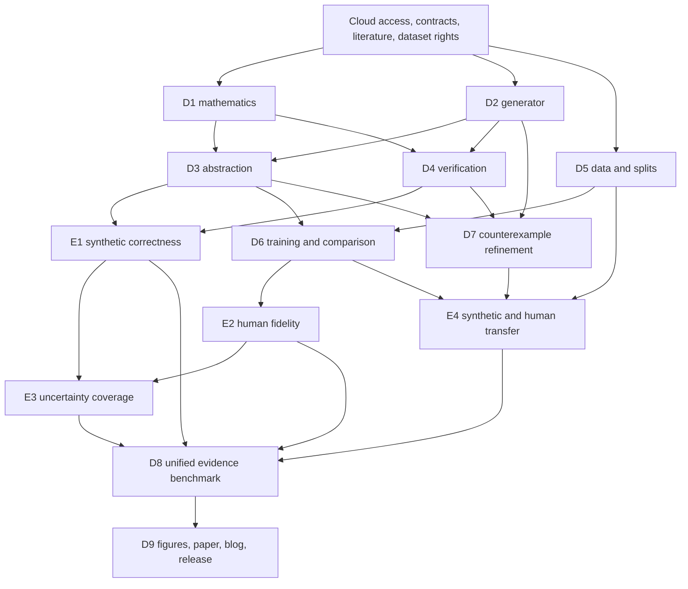

# Behavioral equivalence under uncertainty

Primitive Labs research execution architecture, v0.1, 2026-10-15.

## Root goal and completion contract

Build, execute, evaluate, and package the entire research program. Cover all nine deliverables and four experiments in one resumable campaign. Completion means reproducible evidence and honest conclusions, including negative findings. Scientific success is a separate outcome from completion of the work.

The persistent Codex goal tracks the full program. `configs/program.json` defines work packages and dependencies. `reports/execution-state.json` records execution state. This document defines scientific and integration contracts. Frozen synthetic correctness, uncertainty and intervention campaigns have completed. Final human predictive and intervention evaluations remain open. Source-bound controllers execute actual cloud jobs; the planner itself submits none, and a unified campaign runner remains incomplete.

Three claim levels remain separate: mathematical model correctness, held-out human predictive fidelity, and transfer under supported human interventions. Record each as supported, unsupported, inconclusive, or unavailable with evidence. Missing human intervention data leaves the strongest claim unavailable and the full intended human intervention evaluation incomplete. It never counts as a positive result.

## Program structure

A, Formal Methods, owns D1 and D4 and co-owns D8. B, Behavioral ML, owns D3 and D6. C, Simulation and Environments, owns D2 and D7. D, Data and Evaluation, owns D5 and co-owns D8. The research lead owns D9, protocol freezes, interfaces, claim review, and integration. These are accountable roles; named human assignments remain unassigned. Four logical lanes can progress concurrently. Agent execution must respect the available concurrency limit, isolated worktrees, and independent scientific review.

The original three-part narrative becomes four executable experiments: E1 synthetic mathematical correctness, E2 human predictive fidelity, E3 transition uncertainty, and E4 counterexample transfer. E3 is a separate experiment because coverage needs its own repeated-sampling design. E4 contains distinct synthetic and human intervention analyses.

Each numerical synthetic experiment has its own immutable execution freeze: P03S for correctness, P03U for uncertainty, and P03I for intervention transfer. Their source-bound controllers, budgets and protocols permit execution independently of later human-data decisions. P03 remains the final human-test freeze and is incomplete. Final claim review still requires A02 theorem review, P02 schema unification, D08B integrated evidence audit and R03 reproduction. Numerical experiment completion cannot bypass those release obligations. This replaces the original overly broad dependency that made every synthetic run wait for the entire human protocol.

## Deliverable contracts

### D1. Mathematical framework, owner A

Output `spec/model.md`, `spec/proofs.md`, property catalog, assumptions, proof obligations, numerical error policy, and a certificate schema. Specify finite labeled Markov chains with a fixed policy, an explicit environment family, and initial-state correspondence. Define observable labels before merging. Distinguish finite-state Markov sufficiency from assumptions about human cognition.

Define exact lumpability/bisimulation and approximate certificates relative to the actual quotient transition row. Pairwise epsilon closeness is not transitive: connected-component clustering can create classes exceeding epsilon. Recheck every concrete state against its chosen abstract row after every merge or split. A representative row or convex combination needs an explicitly proved bound. Include initial-distribution mismatch eta where applicable.

For uniform one-step relation-preserving coupling error epsilon, prove the finite-horizon path-event discrepancy bound 1-(1-epsilon)^H, with matched labels and appropriate initial coupling. State the event language, fixed policy, horizon counting convention, and environment quantification. With initial coupling failure eta, use 1-(1-eta)(1-epsilon)^H. If no uniform certificate exists, report the model as uncertified. Distinguish mathematical proof from numerical validation and mechanical formalization.

For uncertainty, specify a mapping from every allowed concrete kernel to a permitted abstract kernel with the certified discrepancy. A bound for one estimated kernel does not automatically apply uniformly to a confidence set. Allocate simultaneous statistical failure probability across rows, environments, and properties as needed. Track sampling, abstraction, and numerical error separately. Establish the combination theorem conditional on confidence-set inclusion. Arbitrary uncertain-kernel dependence cannot silently become rectangular independence.

Acceptance: proofs reviewed independently from implementation, documented limitations, edge cases at H=0 and epsilon=0 or 1, initial mismatch, absorbing labels, and a counterexample showing why naive transitive approximate merging fails.

### D2. Synthetic generator, owner C

Output deterministic sparse transition systems, ground-truth partitions, environment parameters, rational small-model fixtures, and oracle properties. Five mechanism families: preference switching, finite belief updates, trust/risk transitions, patience/stopping, and history/memory. Finite belief discretization must be explicit. These families are assumptions, not recovered cognitive mechanisms.

Main suite: 5 families x 3 sizes (32,128,512) x 4 perturbation regimes (0,.005,.01,.03) x 20 seeds = 1,200 worlds. Evaluate each world at H=5,10,25,50. These horizons produce 4,800 world-horizon combinations, not 4,800 independent worlds. Encode exact, approximate, and environment-sensitive types explicitly. To avoid multiplying the proposed main suite silently, main perturbation=0 worlds serve exact tests and nonzero regimes approximate tests; use a separately counted intervention suite for environment-sensitive systems.

Acceptance: row stochasticity, labels, seed replay hashes, ground-truth equivalence recovered, perturbation bounds measured after normalization, deliberately nonequivalent states preserved, and rational independently computable cases. Specify redundancy ratios and sparse/dense connectivity before the confirmatory freeze.

### D3. Abstraction and representation learning, owner B

Output exact partition refinement, certified approximate merges, embedding clustering, future-prediction clustering, random merging, and verification-guided refinement. Compare methods at matched state counts and underlying encoders. Learn encoders on training data; choose merges/tolerances using training and validation only; use reserved calibration data for certified transitions. If calibration informs refinement, reserve fresh calibration data or use a guarantee valid under adaptive selection.

Learned states need observable output distributions. Use a labeled-state construction or state augmentation to preserve events where outcomes depend on transitions. Record how continuous histories map into discrete states, how unseen histories map, and how the induced initial distribution is obtained. Test conditional future dependence on longer history and context to detect non-Markov abstractions.

Acceptance: all methods run through the same property interface; every certified reduction includes concrete-to-abstract mapping and maximum measured/certified row discrepancy; report the full compression-error frontier. Equal predictive distributions for one outcome do not establish bisimulation.

### D4. Verification, owner A

Output PRISM adapter as primary backend, independent bounded-horizon dynamic programming, rational small-model oracle, solver logs, and machine-readable certificates. Use Storm as an optional second backend after capability checks; do not assume identical uncertainty semantics or APIs. PRISM officially supports interval DTMCs and robust min/max queries [S1,S2].

Primary uncertain semantics: row-rectangular, adversarial choices at each step, explicitly labeled conservative for a fixed unknown kernel. If reporting fixed-kernel tightness, solve that problem separately; do not relabel rectangular extrema. Test feasibility of interval rows. Reachability, survival, forbidden-state, and conditional properties require precise encodings. Handle zero-probability conditioning explicitly.

Acceptance: independent implementations agree within preregistered numerical tolerance; rational cases bound floating error; widened final intervals include numerical allowance; unsupported properties fail explicitly; certificate corruption and invalid partitions are rejected. A separating witness is distinct from a violation of a temporal requirement. The system must produce whichever artifact it actually established.

### D5. Human-data pipeline, owner D

Output source/license register, download checksums, schema mapping, timestamp and duplicate audit, censoring rules, outcome definitions, trajectory builder, split manifests, feature-availability audit, and statistical analysis plan. KuaiRand-1K is the pilot candidate and 27K the final candidate. Pure has incomplete sequences and cannot replace 27K for the primary sequential claims [S3].

The official repository LICENSE is CC BY-SA 4.0 [S4]. Record attribution/share-alike obligations and verify dataset-specific terms and applicable archive notices. Commercial permission, redistribution, personal-data restrictions, and weight-release conditions are separate fields. The repository license alone is not a completed dataset scope review. Use a clearly licensed alternative meeting the same sequence and intervention requirements if needed; lock the change before final testing. No unsolicited access emails.

Protocol A: per-user chronological train/validation/calibration/test, with cutoff eligibility, embargo where overlapping targets cross boundaries, and no future-derived features. Protocol B: user-disjoint groups, with separate validation/calibration/test users. Lock IDs and dates before training; fit normalizers, vocabularies, clusters, and imputation on training only. Sequential test history may include observations already revealed before each prediction, under a frozen inference protocol. Avoid overlapping pilot and confirmatory test users, especially since 1K is a subset of 27K.

Acceptance: leakage tests intentionally inject future features, crossing windows, overlapping users, and target-derived fields; the audit catches them. Missing next events at the end of logging are censored, not intentional abandonment. Randomized exposures require assignment and support audits.

### D6. Training and human comparison, owner B

Output Markov, GRU, Transformer, and learned discrete-state predictors; checkpoints; training traces; calibration fits; predictions keyed by immutable case IDs; complexity profiles; and paired evaluation. K in {16,32,64,128,256}. Use a pilot-fixed architecture search and equal tuning budgets. Train at least five seeds per selected final neural configuration as a provisional minimum, finalized from pilot variability and budget. Preserve both within-user sampling variation and training-seed variation.

Primary outcome and aggregation must be frozen: propose binary next-click log loss as the initial primary, with watch-time categories and feedback secondary. Report user-weighted and interaction-weighted estimates, declaring one primary. Define the comparison against each encoder's original discrete model for the compression claim; compare continuous strong models separately for practical usefulness. Fix shared predictive output smoothing using training/validation to avoid undefined log loss.

Primary noninferiority target: at least 2x state compression and upper endpoint of a paired user-clustered 95% interval for additional NLL below .01 nats per prediction. Plan sample size using pilot user-level variation and a prespecified power target. The margin is a decision threshold, not a promised result. Choose the operating point on validation only. Report failure and the frontier if the target is unmet. Epsilon does not directly bound unbounded log loss without further assumptions; do not confuse the event-probability theorem with the empirical NLL criterion.

Acceptance: frozen case alignment, user-clustered inference, strong baselines, multi-step errors, Brier/calibration, state/edge counts, CPU/GPU time and memory, rare-state results, and both split protocols. Avoid adding per-property p-values without a multiplicity plan.

### D7. Counterexample interventions, owner C

Output a feasible intervention schema, environment optimizer, witness generator, split/reestimate/reverify loop, and held-out intervention evaluations. Synthetic interventions vary reward, price/effort, information, actions, waiting, constraints, and memory. Compare JS-disagreement search with random and fixed grids at equal environment evaluations and report wall time. Include negative controls and a simple active-design baseline. Independently evaluate witnesses on the true synthetic kernel so model uncertainty cannot masquerade as an intervention effect.

Training environment families, search pool, validation interventions, and final unseen interventions are disjoint. Search has a fixed evaluation budget and stopping rule. Refit on the same new observations supplied to all methods; compare extra-data-only, extra-states-only, random splits, and targeted refinement. This separates refinement gains from greater capacity or data. Never search against the final test interventions.

Human branch: estimate response under supported observed randomized exposures using prespecified treatment strata with overlap. Keep assignment information, exposure probabilities, estimand, user clustering, and treatment-selection timing explicit. Randomized item exposure does not automatically randomize every content attribute or a full future trajectory. Multi-step intervention claims need sequential identification conditions. No arbitrary checkout changes enter the human counterfactual claim.

Acceptance: synthetic invalid-merge recovery plus held-out improvement at matched data/capacity budgets; human improvement with uncertainty against strong sequence and design baselines where assignment/support permit it. If suitable data are unavailable, retain an open human-transfer dependency and report synthetic evidence separately.

### D8. Unified benchmark, owners A and D

Output common run registry, certificate validator, metric definitions, paired statistical analysis, ablations, failure inventory, and a claims-to-evidence matrix. E1 checks bounds on every known world. E2 tests predictive noninferiority. E3 measures repeated-sampling confidence-set and event-probability coverage. E4 tests independent intervention transfer.

E3 synthetic design: freeze representative worlds; vary transition sample sizes and visitation imbalance; repeatedly gather independent datasets and rebuild the fitted pipeline. Coverage compares intervals with known generating event probabilities. Record simultaneous kernel-set inclusion and end-to-end outcome coverage separately. Choose replication count from desired Monte Carlo precision and publish binomial uncertainty on coverage. Additional repetitions are not additional worlds.

E3 human design: probabilities are unknown. Use independent cohort event-rate estimates, repeated temporal cohorts where justified, proper scoring and calibration, and model-misspecification diagnostics. Report uncertainty in the empirical reference itself. A single binary outcome cannot establish confidence-interval coverage for a probability. Do not label human calibration as a distribution-free model guarantee.

Ablations cover equivalence constraints, uncertainty, refinement, history, exact versus approximate merging, horizons, sample size, and environment diversity. Include negative controls. Use one prespecified primary comparison per claim, simultaneous intervals or multiplicity correction for confirmatory secondary claims, exploratory labels elsewhere. Retain failures, wide intervals, unsupported states, and drift.

Acceptance: one report reproduces E1-E4 from immutable artifacts, distinguishes sampling units, and detects a deliberately corrupted certificate, leaking split, and misaligned prediction file. Independent fresh-environment reproduction must succeed before release.

### D9. Publication and reproducibility, owner lead

Output paper draft, technical blog draft, code release candidate, model/data cards, attribution notices, environment locks, rerun instructions, and six figures generated from measured evidence: graph quotient, compression frontier, actual errors versus certified bounds, nominal/robust/adjusted intervals, intervention witness/refinement, and held-out human results. Add runtime and sensitivity panels when supported.

Every number links to run, artifact hash, config, code revision, and aggregation script. Explain negative findings and unsupported claims. An unsuccessful scientific hypothesis still warrants an accurate report. Provide a small cloud reproduction and full campaign instructions. Release code and permitted synthetic artifacts; distribute raw human data or weights only when their rights review permits it. Prepare the public release without treating unreviewed publication as an automatic action. Open feature-branch PRs after the required QA gate; never self-merge.

Acceptance: evidence-complete claim audit, clean reproduction, all nine deliverables reviewed, six genuine measured figures, downloadable permitted release assets, and explicit distinction between release prepared and publicly published.

## Cloud execution and artifact contracts

Use Modal CPU tasks for download/streaming ETL, synthetic worlds, solvers, uncertainty replication, bootstrap, and report generation. Use Modal GPUs for GRU/Transformer/latent-state training and batched inference. Select hardware from pilot throughput rather than defaulting every task to an expensive GPU. Long jobs detach and checkpoint. Modal Volumes store reusable data/checkpoints [S5]; immutable research R2 objects hold archived evidence [S6]. Local work remains source editing, orchestration, lightweight tests, and small report inspection.

Use Fireworks for optional LLM sequence baselines or constrained intervention proposals when a language model adds a testable comparison. It is not required for Markov/GRU training or proofs. Its managed and custom training surfaces have different capabilities [S7]. Any generated proposal passes a deterministic feasibility check and kernel evaluation. LLM outputs never become real human observations. Pin model identifiers, prompts, parameters, responses, and costs. Do not assume R2 supports every Fireworks bring-your-own-bucket integration.

Use the existing research-isolated `primitive-research` R2 bucket only after verifying access, with `behavioral-equivalence/objects/sha256/<digest>` and versioned campaign manifests. Keep restricted raw data private; archive derived data only as permitted. A bucket name does not enforce immutability: implement conditional create, hash verification, least-privilege writers, and no-overwrite policy. Modal needs actual scoped cloud credentials; local Wrangler OAuth does not automatically authenticate a remote container. Record verified read/write roundtrips before production jobs. Workers/D1 are optional later for shared status, not prerequisites for this research runner.

Each run record contains campaign/run/task ID, parent artifact hashes, code revision and dirty-diff digest, image/dependency lock hash, dataset/split/encoder/partition IDs, seeds, property/horizon/environment IDs, backend/version/semantics, resource shape, timestamps, cloud job ID, status, cost estimate and actual billing, output hashes, and failure reason. Each certificate additionally contains labels, relation/mapping, initial coupling, quotient-construction rule, epsilon evidence, statistical confidence allocation, uncertainty-set definition, numerical allowance, robust interval, final interval, and proof/spec revision.

Stable interface objects: `WorldSpec`, `TrajectoryShard`, `SplitManifest`, `PredictorArtifact`, `AbstractionArtifact`, `PropertySpec`, `UncertaintySet`, `Certificate`, `PredictionShard`, `EvaluationReport`, and `ReleaseManifest`. Version and validate schemas before implementation fans out. Workstreams integrate against executable small fixtures, not empty interface stubs.

## Autonomous execution policy

One campaign entry point is the implementation target: `python -m behavioral_equivalence campaign run --config configs/program.json`. This command does not exist yet. Implement a dry-run planner, cloud access preflight, deterministic task IDs, dependency scheduling, detached cloud submission, status reconciliation, checkpoints, bounded infrastructure retries, and resume. A successful cloud submission is running, never complete. Completion requires validated output artifacts. Restarting the orchestrator must reconcile cloud IDs before submitting duplicate jobs. Resume from compatible artifacts only; changed code/config/data invalidates descendants.

Task states: planned, ready, running, complete, failed, blocked. Scientific outcomes are separate. A false hypothesis completes a valid experiment; broken mathematics blocks certification descendants; missing licenses block only affected data descendants. Continue all independent work. Retry transient infrastructure failures with bounded backoff; preserve deterministic scientific failures for diagnosis. A report must list unavailable work rather than fabricate results or call the whole intended program finished.

No cloud-spend ceiling has been supplied. Record it as unresolved, never unlimited. Obtain a ceiling while building locally small control files and checking read-only access. Before large sweeps, measure representative CPU/GPU pilot jobs, project total cost from enumerated jobs, and reserve 20% for failed jobs/reproduction. Proposed allocation of the remaining usable budget: 15% synthetic/formal, 45% human training, 15% uncertainty, 15% transfer, 10% reporting/reproduction, adjusted to measured costs before freeze. Enforce campaign and per-task reservations atomically, timeouts, maximum retries, and finite search budgets. Research coverage stays explicit if resources cannot fund the preregistered design.

## Execution waves and decision rules

Wave 0: establish workspace, source audit, cloud access/quota, contracts, license register, and protocol skeleton. Start all four lanes immediately. Wave 1: small rational and redundant worlds, minimal solver adapter, data ETL and leakage audit, simple Markov/GRU pilots, and candidate counterexample fixture. Wave 2: prove the certificate rule, integrate exact/approximate methods and uncertainty engine, profile the full stack, complete human and intervention feasibility checks. Wave 3: use pilot-only results to fix power, sample sizes, seed lists, resources, outcomes, margins, tuning budget, and multiplicity. Freeze immutable confirmatory config and isolate final tests. Wave 4: run full E1-E4 campaigns and predeclared ablations, then independently reproduce and publish the evidence package.

Checks are automated scientific controls, not recurring requests for approval. Never inspect a final test, change the method, and reuse it as if untouched. A material post-freeze change creates a new campaign with a new untouched evaluation or an explicit exploratory label. No automatic stopping after E1. No need to achieve a positive result to finish E2-E4 reporting. Unsupported human intervention evidence remains a genuine limitation, not a substituted synthetic result.

Planning estimate, moderate confidence: about 1-2 weeks for integrated pilots and 4-8 weeks for a defensible full program with four technical owners once access is ready. Data permissions, solver integration, and repeat-training variability can extend this. Cloud runtime and spend are unknown until profiling. AI/cloud concurrency does not eliminate mathematical review or empirical data requirements.

## Verified foundations and unresolved items

[S1] PRISM uncertainty syntax: https://www.prismmodelchecker.org/manual/ThePRISMLanguage/UncertainModels
[S2] PRISM uncertainty properties: https://www.prismmodelchecker.org/manual/PropertySpecification/UncertainModels
[S3] Official KuaiRand repository and sequential-release descriptions: https://github.com/chongminggao/KuaiRand
[S4] Official repository license: https://raw.githubusercontent.com/chongminggao/KuaiRand/main/LICENSE ; dataset archive: https://zenodo.org/records/10439422
[S5] Modal Volumes: https://modal.com/docs/guide/volumes
[S6] R2 API: https://developers.cloudflare.com/r2/api/
[S7] Fireworks training surfaces: https://docs.fireworks.ai/fine-tuning/finetuning-intro

Checked 2026-10-15. These sources establish platform/dataset facts, not novelty or theorem proofs. D1 includes a dedicated primary-literature review of probabilistic bisimulation, approximate abstraction, predictive-state equivalence, robust uncertainty semantics, and statistical model checking. Open items: dataset scope review, human intervention estimand/overlap, actual cloud authentication, cloud budget, solver version pinning, power, numerical tolerance, final replicate counts, and named reviewers.
