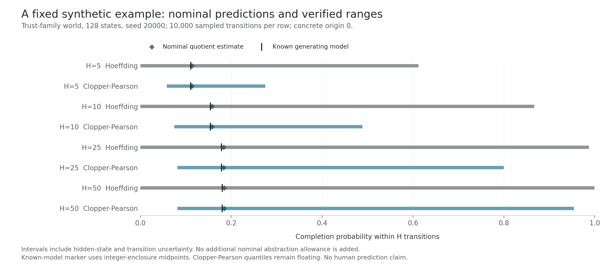

# Different States, Same Behavior?

Primitive Labs research draft. Unpublished, October 15, 2026. All primary, trajectory and supplementary endpoint evaluations are scored and numerically audited. Fresh source reproduction has passed; release assembly remains in progress.

Imagine two recorded histories. One person clicks after comparing several items; another clicks immediately. A model assigns both histories the same next-click probability. That illustrative agreement raises a useful question: can we represent the two histories with one state?

One matching forecast is insufficient. The histories could predict different response sequences, or react differently when the available content changes. We need to specify which future observations and environments must remain interchangeable.

Our research program asks whether a system can learn those distinctions, remove unnecessary state and quantify the consequences. The completed experiments also show why a mathematical certificate can be correct while a behavioral prediction remains unhelpful.

## What the certificate means

We represent a fixed-policy process as a labeled stochastic model. A partition merges states only while preserving the labels relevant to the prediction. Its approximation radius compares every concrete successor row with the actual reduced-model row, after aggregating both onto the same classes.

With matching initial labels and a uniform one-step mismatch allowance epsilon, a coupling argument bounds the change in an observable H-step event by

\[
1-(1-\epsilon)^H.
\]

This mathematical foundation is established [prior work](https://arxiv.org/html/1701.04547v3), not our new theorem. Our task is to make the calculation operational, preserve its assumptions and test whether the resulting representations help on human observations. Existing [interval-abstraction research](https://arxiv.org/html/1804.08554v1) also prevents us from claiming that abstraction plus uncertainty checking is itself novel.

The certificate concerns the specified model. It cannot establish that a finite learned state captures human cognition, or that its transition law remains stable after a product change.

## The synthetic system works, with numerical qualifications

The main benchmark contains 1,200 controlled worlds. We generated 26,400 abstraction records, compared 422,400 properties and ran 55,200 independent PRISM point checks. Exact-normalized numerical certificates accompany the predictions.

Auditing found ten differences between the requested tolerance and the actual serialized quotient radius. The largest excess was about 1.74e-17. Nine hundred nominally exact serialized quotients also had tiny nonzero radii. Those findings are numerically small, but they matter to the claim: the certificate must use the quotient actually produced. We retain them rather than reporting literal zero error.

## Conservative uncertainty can become useless

In the repeated synthetic uncertainty study, all evaluated robust outcome envelopes contain the known generating probabilities. Many ranges are broad or vacuous. A point-estimate control is narrower but often misses: under imbalanced sampling with known terminal closure, it contains every tested probability in only 102 of 2,000 datasets. The robust and nominal procedures have different assumptions; a miss outside the assumed model family does not make a conditional numerical certificate unsound.

The real-data construction exposes an even sharper precision problem. We treat users, rather than their repeated interactions, as potential independent sampling units. This allows arbitrary dependence within each user's capped calibration history. The assumptions still require scrutiny, especially when the representation was learned from those same users' earlier records.

Across all ten fitted human representations, every 256-state emission interval spans [0,1]. The unseen-user models are wholly vacuous at 64 and 128 states too. Smaller models retain some information, but their ranges remain wide. This is a negative result: these conservative intervals offer little predictive guidance at the tested state granularities. They are not evidence of reliable human coverage merely because they are wide.

## Refinement and active search are different claims

Our synthetic intervention experiment creates environments that distinguish previously merged states. Targeted refinement improves the fixed comparison against random-capacity splitting. But holding refinement fixed, random and grid search outperform the tested RBF active-search heuristic.

The evidence supports useful splitting under these conditions. It does not support superiority of that active search method. All search controls and response-invariant worlds remain in the analysis.

## The fixed human compression target fails

All 30 context-only, GRU and Transformer fits are complete. Every one of the ten fixed primary state abstractions retains all 256 states. None meets the required twofold reduction.

Secondary finite-property variants retain 200 to 211 states. Other quantizations and clustering controls may trade accuracy against size differently, but they cannot replace the failed primary. Nor does a noninferior identity partition establish useful compression. This failure applies to the chosen representation, estimated kernel, tolerance and construction rule. It is not a lower bound on how much behavioral state humans need.

## Human generalization is being measured separately

The final analysis is internally locked across four phases and 50 jobs. It retains five seeds, both prediction protocols, every fixed control and separate feedback-availability sensitivities. The lock and its 113 input identities are archived privately. This is an internal pre-test analysis lock, not external preregistration or independent review.

Direct multistep heads use only origin-available features. They do not read future content to predict that future, and they are marginal event predictors rather than simulated generative journeys. Unavailable horizons are censored, not labeled as negative responses or abandonment.

Two response studies have different meanings. Study A estimates future responses after calibrating on all known-duration groups. Study B withholds complementary duration groups from response calibration and refinement, across all six group pairs. The base encoders have already encountered those groups in ordinary training. Study B therefore concerns withheld calibration conditions, not unseen interfaces or zero-shot environments. Its three eligible forecasts per case are averaged as losses before user aggregation, without creating extra independent observations.

Both human response studies are fully scored. Neither establishes improvement across all five fixed seeds. In Study A, four seeds improve loss, while one interval crosses zero. In the withheld-calibration-condition study, one seed is worse and another produces exactly the same targeted and control forecasts. We retain every seed and fold. These results do not support a generalization-success claim. [The complete per-seed results](human-response-final-decisions.md) passed the independent aggregate-output audit.

## What the completed evidence supports

The 50-job primary matrix and six measured figures are complete. Primary and trajectory output replay are complete. The supplementary endpoint audit is complete. Fresh reproduction passes 626 tests without skips and a small all-mechanism scientific rerun with 20 PRISM checks. Final release assembly and verification remain unfinished. The eventual conclusion will include the failed compression target, vacuous intervals and negative search result alongside any supported predictive findings.

This program is useful only if it tells us both what a reduced behavioral model preserves and when its predictions stop being informative. The [paper draft](paper-draft.md), [complete uncertainty results](human-cluster-uncertainty-results.md) and [deliverable evidence index](deliverable-evidence.json) track those separate claims. No external language-model inference is used in the research pipeline.

The measured human [compression frontier](figures/human-final-d424315e2f17fb77/figure-02-human-frontier.png) and [fidelity panels](figures/human-final-d424315e2f17fb77/figure-06-human-fidelity.png) retain all five fits. Interval widths in the fidelity panel weight test origins by original users; calibration reports that average state rows use a different weighting. The separately frozen exploratory feedback/watch-time study is [fully scored and audited](supplementary-endpoint-results.md). Its fixed abstraction meets both descriptive compression/loss checks in 46 of 60 endpoint/fit cases, while watch-time fails twofold compression in all ten fits. This does not replace the primary click finding.

The separately frozen [joint trajectory study](human-trajectory-results.md) is complete across all ten fits, with 450 metric cells and 400 paired contrasts independently replayed by backward likelihood and explicit user resampling. It evaluates an outcome-blind 4,096-origin sample per protocol, conditional on observed horizons; it does not change the primary compression or response decisions.

The [paper draft](paper-draft.md#measured-figures) contains all six measured figures, with links to their source-bound captions and data. The complete baseline, marginal-horizon, joint-trajectory and availability/history results are retained alongside the primary decisions.

## Six measured figures

Figure 1 shows a measured 32-state synthetic trust world reduced to eight equivalence classes. Graph positions have no psychological meaning, and the panels use different edge-width scales.

Figure 2 retains all five fits for each protocol. All ten strict primary abstractions remain at 256 states and fail the twofold-compression target.

Figure 3 compares measured synthetic property differences with bounds calculated for the actual serialized quotient, including tiny nonzero radii in nominally exact reductions.

Figure 4 separates parameter uncertainty from abstraction allowance. Wide containment remains a limited result: an uninformative range does not establish useful prediction.

Figure 5 gives a synthetic witness, not a human intervention result. The full benchmark separately compares refinement and search, and the tested active-search heuristic loses to random and grid search.

Figure 6 preserves negative findings across fits. Its interval-width panel weights test origins by original users; equally weighted state-row diagnostics answer a different question. See the [paper captions and source evidence](paper-draft.md#measured-figures) for exact scopes.

The release library subsequently corrects numeric-boundary handling in eight modules: teacher-emission fallback buffers, support and response cell keys, item lookup, and fingerprint serialization in preparation and independent auditing, unsigned response-prior keys, and exact empirical response counts. Both recorded training callers use Python floats, whose operation remains identical. The support pipeline uses signed user IDs and narrow environment codes, whose counts also remain identical; historical outputs stay frozen. The [correction and source record](preflight/source-correction-ad74b89a721bbbba.json) separates the corrected library from the historical cloud-tested source. Its installed wheel passed 1627 tests locally with three Torch-dependent skips and three retained local numerical-backend warnings. The current 490-file archive subsequently passed [fresh pinned cloud validation](preflight/source-package-reproduction-ad74b89a721bbbba-e52eea4696b4-explicit-mount.json): 1635 installed-wheel tests, zero skips, with warnings treated as errors, plus ten synthetic worlds, ten certificate replays and twenty independent PRISM queries. The first detached launch failed while recording checker-source provenance; a separately reserved retry mounted the identical checker explicitly. The supplementary counting tool also corrects unsigned state-index promotion, preserving its original source and frozen supplementary source maps. State-sufficiency grouping also preserves large integer identities, and calibration replay rejects nonfinite values. Original tool sources are preserved. These changes do not alter recorded signed-state counts or retained results. The new zero-skips cloud run validates the corrected release source; historical full experiments and human forecasts remain frozen. A subsequent test-only source extension adds sixteen locally passing release-checker failure tests; all prior source bytes are unchanged. Twelve further local cases verify the actual final evaluators reject corrupted freezes before reading test data. Those earlier executions were separate. The complete 492-file package subsequently passed [a fresh pinned cloud run](preflight/source-package-reproduction-ecc5a586bd135738-e52eea4696b4.json): 1663 installed-wheel tests, zero skips, warnings as errors, plus the ten-world scientific and twenty-query PRISM subset. Its wheel hash is identical to the prior corrected library wheel.
