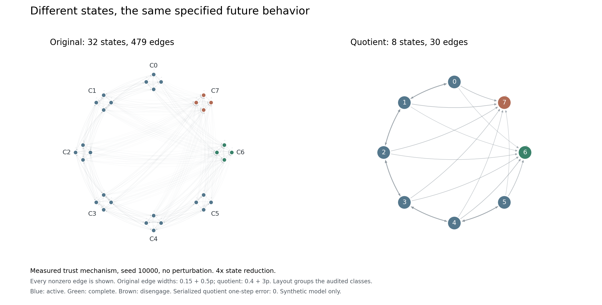
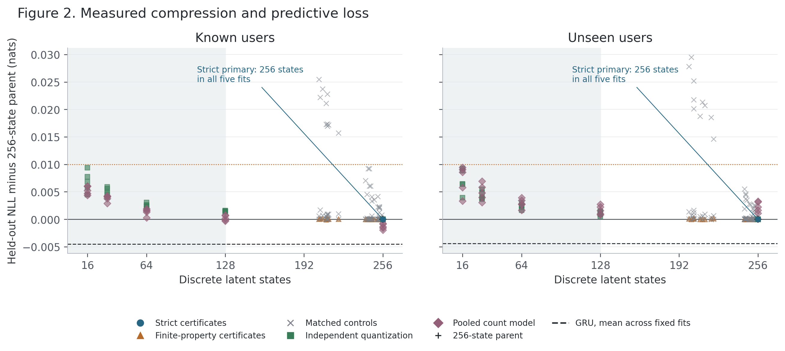
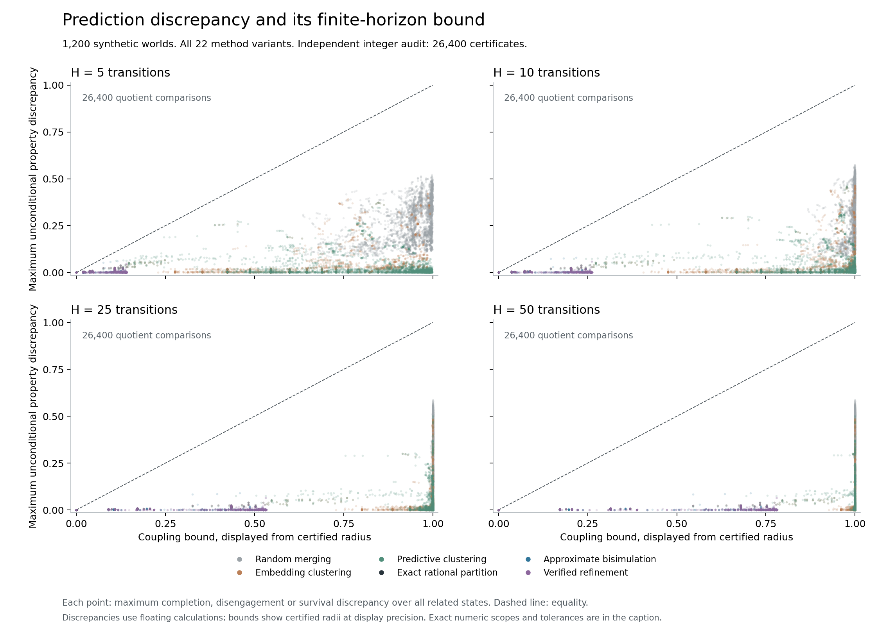
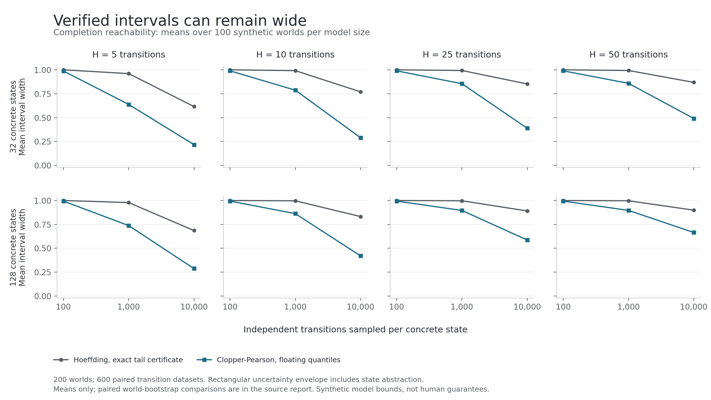
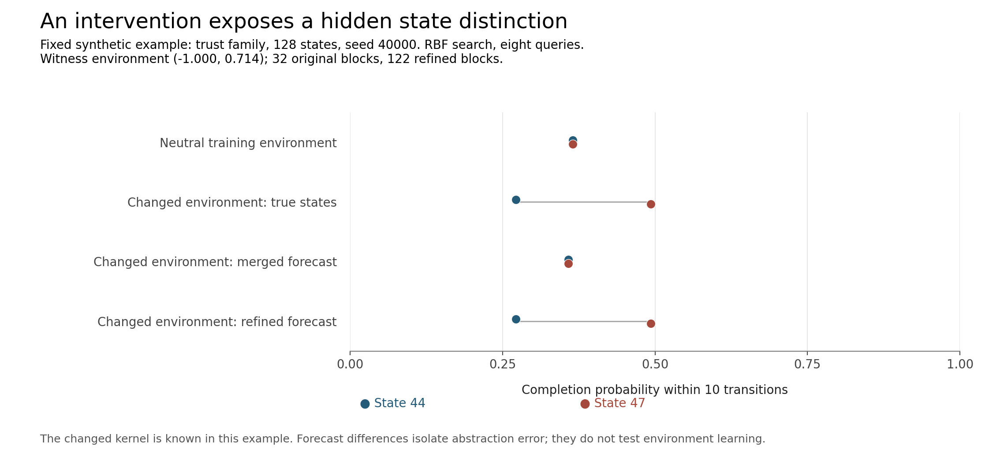
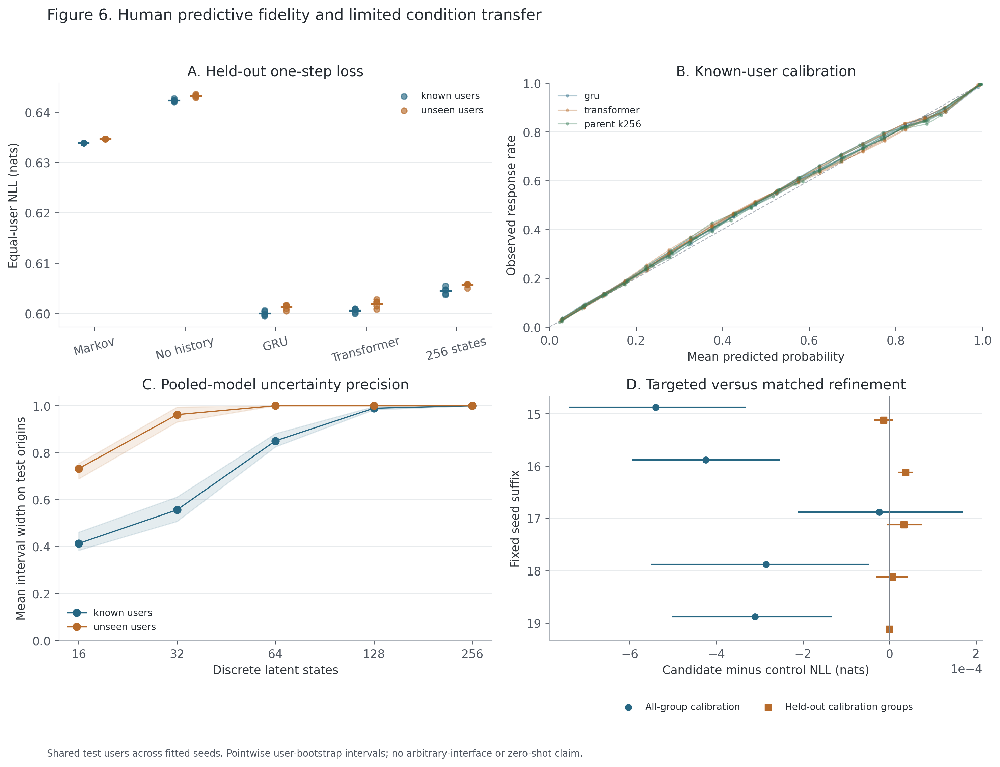

# Behavioral Quotients: Compact Behavioral Models with Verified Predictive Bounds

Primitive Labs. Interim research manuscript, October 15, 2026. Unpublished. All primary and supplementary human scoring and numerical output audits are complete. Fresh source-package reproduction has passed; final release assembly and verification remain in progress.

## Abstract

We investigate whether finite behavioral prediction models can be compressed while preserving specified observable forecasts. Our system combines learned partitions, approximate probabilistic bisimulation, exact-normalized numerical certificates and independent probabilistic model checking. Across 1,200 synthetic worlds, 26,400 abstraction records produce 422,400 property comparisons and 55,200 PRISM point checks. Numerical auditing exposes small differences between requested merge tolerances and actual serialized quotient errors, which the certificates retain. In a separate 4,000-dataset uncertainty study, all evaluated robust outcome envelopes contain the generating probabilities, but many are wide or vacuous. Synthetic interventions support targeted refinement while contradicting superiority of the tested active environment-search heuristic. All 30 human sequence-model fits and ten fixed abstraction frontiers are complete. Every primary strict abstraction retains all 256 states and fails the twofold compression target. Conservative user-cluster uncertainty intervals are wholly vacuous at 256 states in every fitted human model. All 50 locked primary human evaluations are scored; independent aggregate-output replay is complete. These findings establish an auditable model-analysis workflow and important limitations; useful human predictive compression and generalization remain empirical questions.

## 1. Contribution and prior work

The candidate contribution is operational integration and evaluation, not a new equivalence theorem or a recovered theory of cognition. [Bian and Abate](https://arxiv.org/html/1701.04547v3) establish finite-horizon trace bounds from approximate probabilistic bisimulation. [Zacchia Lun and colleagues](https://arxiv.org/html/1804.08554v1) study interval-based Markov-chain abstractions and representatives. We therefore claim neither the general coupling bound nor the combination of abstraction and interval verification as novel.

Our implementation certifies a particular partition against its actual quotient, keeps numerical and statistical assumptions explicit, and tests preservation separately from human predictive fidelity. It does not establish minimum-cardinality abstractions, all-future predictive sufficiency or unique psychological states. Predictive-state and computational-mechanics comparisons, including remaining literature-review limits, are recorded in [the theory comparison](../spec/theory-comparison.md).

## 2. Mathematical and numerical specification

For a fixed-policy labeled chain and label-preserving partition q, aggregate each concrete successor distribution onto the abstract blocks. Let Q be the implemented abstract kernel. Its certificate radius is

\[
\epsilon = \max_{e,s}\operatorname{TV}\big(P_e^q(\cdot\mid s),Q_e(\cdot\mid q(s))\big).
\]

This is a uniform concrete-to-quotient condition. Embedding similarity or agreement on one conversion rate does not establish it. With initial block mismatch at most eta, maximal coupling gives, for any common observable event over H graph transitions,

\[
|P(E)-Q(E)|\leq 1-(1-\eta)(1-\epsilon)^H.
\]

The proof constructs matched successor blocks and then samples the concrete state conditionally within its selected block, preserving both transition marginals. Label-path indicators agree until the first mismatch. The local analytical argument, finite-property recurrences, uncertainty quantifiers and conditional-event denominator restrictions appear in [the proof specification](../spec/proofs.md). Lean checks the finite maximal-coupling marginals, the weighted-event inequality and the recurrence/interval components. The [integration argument](../spec/coupling-integration.md) connects them analytically; it is not one end-to-end mechanization. Independent review remains open. The bound does not automatically preserve nested branching-time probability tests or arbitrary unbounded events.

Machine certificates interpret serialized floating values as exact binary-rational weights and normalize rows exactly. Directed integer dynamic programs enclose finite-horizon probabilities; exact rational discrepancies determine the allowance. Floating screening and PRISM output remain separate numerical cross-checks. A finite benchmark supports implementation assessment, not a universal proof by testing.

For an admissible abstract kernel family, robust verification yields [L,U]. Expanding it by a uniform applicable abstraction allowance delta gives [max(0,L-delta),min(1,U+delta)]. The mapping must cover the same concrete kernel family. Rectangular per-step uncertainty can be more conservative than a fixed unknown kernel. [PRISM's uncertainty semantics](https://www.prismmodelchecker.org/manual/PropertySpecification/UncertainModels) guide the backend interpretation. Numerical model bounds do not establish that a human-generating process belongs to the family.

## 3. Experimental design

The synthetic main matrix crosses five mechanism families, state sizes 32/128/512, four perturbation regimes and twenty seeds. Families model preference switching, beliefs, trust/risk, stopping and memory as controlled test mechanisms. They are not validated cognitive theories. Exact and approximate partitions, embedding and predictive controls, matched random merging and refinement share declared properties and budgets.

The uncertainty study retains paired row samples from known worlds. Fixed independent categorical-row assumptions apply only to those experiments. The intervention study separates search procedures from refinement controls and includes 100 response-invariant worlds. An exploratory diversity extension reuses the same generating worlds rather than claiming new independent samples.

The human pipeline uses [KuaiRand](https://github.com/chongminggao/KuaiRand), which provides repeated-user recommendation histories and randomized exposures. Rights and redistribution restrictions are recorded separately. Chronological known-user and disjoint unseen-user protocols separate training, validation, calibration and test roles. Thirty fixed context-only, GRU and Transformer fits use all five seeds in both protocols. Checkpoint selection precedes transition calibration.

The primary strict rule starts from 64 clusters of a 256-state discrete parent and refines to one-step tolerance 0.01. Success requires at least twofold compression and a paired original-user bootstrap upper 95% confidence bound below 0.01 additional nats, in every fixed seed/protocol combination. Full secondary grids and capacity-matched controls cannot replace that primary. Twenty calibration bins and prespecified supported cohorts accompany proper losses.

Feedback availability is a documented proxy because actual arrival timestamps are unavailable. The primary setting uses 24 hours. The same fitted models receive separate audited 0- and 48-hour case/history sensitivity cohorts, not independently retrained replications.

Multistep targets concern recorded click/non-click indicators, click occupancy and cumulative click counts at 1/5/10/25/50 decisions. A negative indicator means a recorded non-click, not explicit dislike or negative feedback. Censoring is not a negative response or intentional abandonment. Direct horizon heads use origin-only frozen features; they are marginal predictors, not generative trajectory models. Finite-state dynamics and weak frozen-origin iid extrapolations are separate comparators. The decision lift exposes one response after one graph step and advances in another, so H decisions correspond to 2H-1 graph transitions.

Two separate response studies use known-user randomized exposures. Study A calibrates on all observed groups. Study B withholds each complementary pair of four known-duration groups from response calibration/refinement, retaining all six query pairs. Base encoders have seen those groups in ordinary training. Thus B tests withheld-calibration-condition prediction, not zero-shot contexts or arbitrary interface changes. Each B case contributes three held-out forecasts: average losses across them before averaging within original users. Forecast copies do not increase the sample count. Controls include the unchanged model, full parent, all fixed selectors and strong sequence baselines.

The joint internal analysis lock binds 113 artifacts, four executable phases and 50 jobs before final scoring. It is not external preregistration or independent scientific review. The fixed designs follow disclosed pilot/calibration diagnostics. Source snapshots, input identities and the complete job plan accompany the lock.

## 4. Results

### 4.1 Synthetic property preservation

The 422,400 comparisons comprise 316,800 unconditional and 105,600 conditional comparisons. PRISM's maximum absolute point discrepancy is 2.3315e-15. Floating bound checks pass at the fixed 1e-10 tolerance. Exact-normalized auditing identifies ten requested-epsilon exceedances, with maximum excess 1.7356e-17. Nine hundred serialized quotients from exact partitions have nonzero radius, at most 4.4702e-17. Certificates use those actual radii. These numerical findings must not be rewritten as literal zero error. See [the complete synthetic results](synthetic-main-results.md).

### 4.2 Synthetic uncertainty and point ablation

The repeated study contains 4,000 retained datasets and 16,000 method/support evaluations. All robust outcome envelopes contain every tested generating probability. Full-kernel membership differs: Hoeffding contains the true kernel in 4,000/4,000 datasets and coordinate Clopper-Pearson in 3,970/4,000.

The paired nominal point control contains all tested probabilities in 1,877/2,000 uniform-allocation and 102/2,000 imbalanced-allocation datasets under known terminal closure. With unknown terminal rows, none of the corresponding point controls contains all tested probabilities. All failures are classified as proven noncontainment rather than numerical ambiguity. Kernel nonmembership and outcome noncontainment are different estimands. The point family has no confidence guarantee; these misses do not invalidate certificates conditional on membership in the assumed family. All 8,000 point/support certificates have separate arithmetic replay. See [the ablation](nominal-ablation-results.md).

### 4.3 Synthetic intervention refinement

Across 400 worlds, the bundled primary refinement-versus-random-capacity contrast has mean error difference -0.004436, with paired 95% interval [-0.007354,-0.001434]. It does not isolate active search. Holding targeted refinement fixed, random and grid search outperform the tested RBF heuristic. Active-search superiority is unsupported. The exploratory same-world diversity extension finds lower prediction error with broader training catalogues; it is not human evidence or an increase in the number of independent worlds. See [intervention results](intervention-results.md) and [the diversity extension](environment-diversity-results.md).

### 4.4 Human state compression and uncertainty

All ten primary strict outputs retain 256/256 states. The compression condition therefore fails for every seed and protocol, independently of later predictive noninferiority. Smallest secondary finite-property variants retain 200 to 211 states. They cover their declared property suite and cannot rescue the strict primary. All ten frontiers and their 670 stored outputs have verified hashes. This is a result about the chosen representation, kernel, tolerance and construction; it is not a lower bound on human behavioral complexity.

A separate bounded-user count-ratio construction permits arbitrary within-user dependence under independent-user and fixed-representation assumptions. It reconstructs the 64-origin cap and produces 50 pooled count-model interval chains. These emissions differ from training-teacher emissions. Every 256-state emission interval is [0,1]. For unseen users, all 64- and 128-state emission rows are also vacuous. At 16 states, across-seed mean widths are 0.7226 to 0.7608 for known users and 0.9216 to 0.9347 for unseen users. These calibration summaries weight state rows equally. Figure 6C instead reports equal-user widths assigned to held-out origins, so the two averages differ. These are probability widths, not loss units or a demonstrated human coverage guarantee. All 100 model/certificate outputs have verified hashes. See [the complete interval construction results](human-cluster-uncertainty-results.md).

### 4.5 Complete human predictive evaluation

The locked primary scoring matrix is complete, with no seed or fold substitution. All 30 direct-horizon fits and 990 output hashes were verified before final scoring. Of their 750 event/horizon heads, 630 are fitted logistic heads, 60 reuse or complement another prediction and 60 encode structural zeros.

Both five-seed response studies are now fully scored, and neither meets its frozen all-five-seed strict-improvement criterion. Each fit evaluates the same 375,340 original cases from 23,284 users. Study A has negative targeted-minus-control loss intervals in four seeds, but seed 20261017 has interval [-0.0002106,0.0001692], which crosses zero. Study B has no strictly negative interval; seed 20261016 is worse by 0.00003680 nats with interval [0.00001989,0.00005347], and seed 20261019 has exactly identical forecasts. These are fitted-model replicates on the same human observations, not independent human samples. All fixed seeds, folds and controls remain. See [the complete per-seed results](human-response-final-decisions.md). The complete 50-job aggregate-output audit passed: 1,660 file hashes, 13,320 proper-loss cells and 290 fixed primary bootstraps. Secondary subgroup calibration and neural forward recomputation remain outside its scope.

Before scoring, structural inspection found identical B targeted/control forecast tables in 18/30 seed/fold comparisons, including every fold of seed 20261019. Strict all-five-seed improvement is impossible for those frozen forecasts. The complete primary matrix is available for final statistical reconciliation. Human Figures 2 and 6 now use all fixed fits and response studies, with visual review and seven matching artifact hashes. See [the measured frontier](figures/human-final-d424315e2f17fb77/figure-02-human-frontier.png) and [human fidelity](figures/human-final-d424315e2f17fb77/figure-06-human-fidelity.png).

The [complete baseline comparison](human-model-comparison.md) retains all five fixed fits per protocol. Known-user GRU NLL ranges from 0.599495 to 0.600561 nats, compared with 0.603714 to 0.605439 for the 256-state parent. Across-seed ranges are descriptive because the fits share human observations. The complete paired comparisons, Brier scores, calibration and 0/24/48-hour availability sensitivities remain in the source-bound reports. Formal probability-preservation bounds do not themselves bound empirical log-loss degradation.

The [within-state diagnostic](state-sufficiency-results.md) finds supported known-user context/tab heterogeneity but no state with two supported history-length strata under the fixed 50-user/2,000-case thresholds. Descriptive maxima are not adjusted discoveries, causal effects or a test establishing Markov sufficiency. Unsupported comparisons are retained explicitly.

## 5. Limitations

Formal soundness concerns specified stochastic models. Human Markov sufficiency, stationary dynamics, population transfer, independent user sampling and feedback timing are separate assumptions. In particular, learning known-user representations from earlier observations does not automatically justify independent-user confidence statements conditional on the fitted representation. Calendar shocks can invalidate user-cluster bootstrap interpretations.

Randomized exposure does not make duration groups or tabs interchangeable randomized treatments, identify arbitrary product interventions, or eliminate release-selection and assignment-probability limitations. Studies A and B retain distinct scopes. Offline selectors share observed calibration tables and do not demonstrate active acquisition efficiency.

The proof draft remains independently unreviewed, and related-work review is scoped and does not certify exhaustive novelty. Shared-concurrency runtime measurements do not establish controlled speedups. Changing source snapshots and optional-environment tests must be disclosed in reproduction claims. Negative compression, vacuous uncertainty and failed search-superiority findings remain part of the result.

## 6. Reproducibility and release status

The private analysis lock, source snapshots and job plan have hash-verified R2 copies. Content-addressed storage is not server-enforced WORM. No external language-model inference is used in the research pipeline. Heavy training and evaluation run on Modal; raw human records, weights and individual predictions stay private.

A fresh installed-wheel cloud check passes 626 tests with zero skips from the 441-file source archive 6b90415e31c165375a0470e0b1b01b488e9afefa6d89d09e508687c66db2f979. It independently extracts and hashes the archive, builds a wheel, confirms imports resolve to the installed wheel and disables source-path injection. The same environment reruns ten fresh 32-state worlds spanning all five mechanism families and six abstraction methods, checks certificates at four horizons and makes 20 pinned PRISM queries; maximum solver difference is 3.3306690738754696e-16. This is a fresh scientific subset, not a second full 1,200-world campaign or retraining of the human encoders. Historical checks and the initial missing-PyArrow environment failure remain retained. Final release assembly and claim verification are tracked in [the deliverable evidence index](deliverable-evidence.json).

## 7. Conclusion

The implemented system measures what a behavioral abstraction preserves and exposes where useful precision is lost. Synthetic results support verified model-level reduction and refinement under declared assumptions. The fixed learned-state compression target fails, and the conservative human uncertainty construction is largely uninformative. The separately frozen feedback study finds endpoint-specific compression, while watch-time remains difficult to compress. Neither human response study meets its frozen all-five improvement criterion. These results support a measured model-analysis workflow, not a general claim of compact human state recovery or reliable interface transfer.

## Supplementary endpoint study

A separately frozen exploratory extension evaluates explicit like, follow, comment, forward and hate feedback, plus four absolute watch-time categories. All 30 frozen-encoder head fits and ten calibration fits are complete. The calibration program produced 300 endpoint/state models and 1,200 independently recomputed abstraction certificates. Its high-dimensional intervals are almost wholly vacuous. All ten held-out endpoint fits pass independent replay: 340 output hashes, 7,200 proper-loss cells, all reported class/top calibration bins and 1,860 paired contrasts. The fixed nominal refinement meets both descriptive engineering checks in 46 of 60 endpoint/fit cases. Watch-time fails twofold compression in all ten fits; rare-label absolute loss margins require caution. This extension was specified after primary click scoring began; it cannot replace or rescue the failed primary compression or all-five response decisions. Categorical Brier scores sum over classes; for binary endpoints that convention is twice the usual positive-class Brier score.

An additional small-model external interval cross-check solves 144 vertex-MDP reachability queries in pinned PRISM 4.11, with maximum discrepancy 1.1102230246251565e-16 from an exact Fraction oracle. It validates the documented rectangular semantics on four dyadic fixtures, not every large uncertainty model. [The encoding proof and backend limitation](../spec/interval-vertex-crosscheck.md) preserve that scope.

The separately frozen [joint trajectory study](human-trajectory-results.md) is complete across all ten fits, with 450 metric cells and 400 paired contrasts independently replayed by backward likelihood and explicit user resampling. It evaluates an outcome-blind 4,096-origin sample per protocol, conditional on observed horizons; it does not change the primary compression or response decisions.

## Measured figures

Figure 1 uses the frozen trust world, seed 10000, with all nonzero transitions. Layout has no psychological interpretation; edge-width scales differ between panels. Exact properties and all plotted probabilities accompany the figure.

Figure 2 retains all fixed candidates and five fits per protocol. Strict, finite-property, unverified controls and independently fitted quantizations remain distinct. The shaded region marks twofold compression; it contains no successful strict primary.

Figure 3 compares model-level errors with actual numerical certificates. Requested tolerance and serialized quotient radius are not conflated.

Figure 4 averages completion interval widths across active states and then equally across generating worlds. These are means, not confidence bands. [The interval example](figures/figure-04/figure04-da567fa770d4/figure-04b-ranges.png) separates nominal estimates, robust bounds and generating probabilities; aggregation is already included in the rectangular envelope.

Figure 5 shows a measured synthetic witness. [The complete comparison figure](figures/figure-05/figure05-a1131dd6a645/figure-05-interventions.pdf) preserves matched refinement and search controls, including the negative active-search finding.

Figure 6 uses complete primary matrices. Test-origin interval widths weight users rather than state rows; they differ from equally weighted calibration-state summaries. Response intervals resample original users, with no independent population replication across fitted seeds. Figure captions, aggregate plotted data and renderer sources retain exact bindings.

The release library subsequently corrects numeric-boundary handling in eight modules: teacher-emission fallback buffers, support and response cell keys, item lookup, and fingerprint serialization in preparation and independent auditing, unsigned response-prior keys, and exact empirical response counts. Both recorded training callers use Python floats, whose operation remains identical. The support pipeline uses signed user IDs and narrow environment codes, whose counts also remain identical; historical outputs stay frozen. The [correction and source record](preflight/source-correction-ad74b89a721bbbba.json) separates the corrected library from the historical cloud-tested source. Its installed wheel passed 1627 tests locally with three Torch-dependent skips and three retained local numerical-backend warnings. The current 490-file archive subsequently passed [fresh pinned cloud validation](preflight/source-package-reproduction-ad74b89a721bbbba-e52eea4696b4-explicit-mount.json): 1635 installed-wheel tests, zero skips, with warnings treated as errors, plus ten synthetic worlds, ten certificate replays and twenty independent PRISM queries. The first detached launch failed while recording checker-source provenance; a separately reserved retry mounted the identical checker explicitly. The supplementary counting tool also corrects unsigned state-index promotion, preserving its original source and frozen supplementary source maps. State-sufficiency grouping also preserves large integer identities, and calibration replay rejects nonfinite values. Original tool sources are preserved. These changes do not alter recorded signed-state counts or retained results. The new zero-skips cloud run validates the corrected release source; historical full experiments and human forecasts remain frozen. A subsequent test-only source extension adds sixteen locally passing release-checker failure tests; all prior source bytes are unchanged. Twelve further local cases verify the actual final evaluators reject corrupted freezes before reading test data. Those earlier executions were separate. The complete 492-file package subsequently passed [a fresh pinned cloud run](preflight/source-package-reproduction-ecc5a586bd135738-e52eea4696b4.json): 1663 installed-wheel tests, zero skips, warnings as errors, plus the ten-world scientific and twenty-query PRISM subset. Its wheel hash is identical to the prior corrected library wheel.
